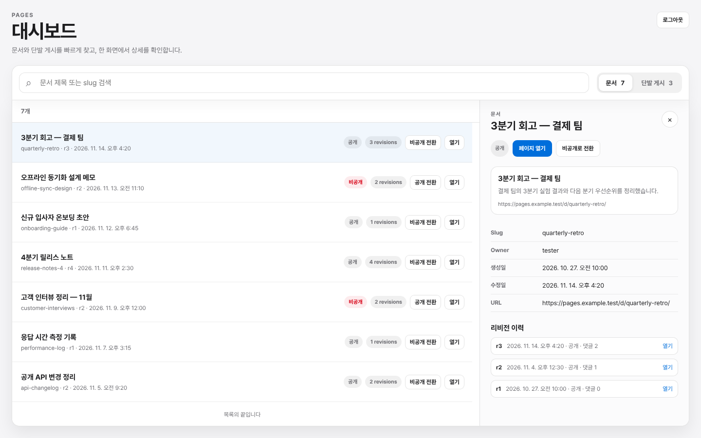

# pages

A lightweight HTML page hosting service running as a Cloudflare Worker. Clients upload HTML or multifile bundles through a Bearer-token-authenticated API and receive a stable page URL; a Google OAuth-protected dashboard lets authorized users manage visibility and deletion.



## Features

- **HTML upload** — POST an HTML string or a multifile bundle and get back a `/p/:id` page URL
- **Document revisions** — opt-in `/d/:slug` stable URLs keep an immutable revision history without changing anonymous uploads
- **Multifile bundles** — opt-in manifest upload serves `index.html` plus relative assets under `/p/:id/...` and `/d/:slug/...`
- **Review annotations** — opt-in reviewable pages receive rev-scoped comment storage and capability tokens
- **Private pages** — a page is public unless it is uploaded with `private: true`; re-publishing into an existing document follows that document's latest revision visibility, and the dashboard can flip visibility at any time
- **Google OAuth dashboard** — only allowlisted Google accounts can access `/` and manage pages
- **Bearer token auth** — API writes require `Authorization: Bearer <token>`
- **Bundle limits** — uploads are capped at 200 files and 50 MB per bundle; request bodies are capped at 75 MB

## Cloudflare resources

- D1 database: `pages` (`af7049be-6ba5-4261-bc05-e5773d3eec33`), bound as `PAGES_DB`
- Private R2 bucket: `pages-content`, bound as `PAGES_BUCKET`; uploaded HTML and bundle files are stored here so private pages are not exposed through a public R2 URL
- Durable Object class `PagesEvents` (SQLite-backed), bound as `PAGES_EVENTS`; it holds the open change-event streams
- Custom domain route: `pages.eiaserinnys.me` in zone `eiaserinnys.me`, configured in `wrangler.toml`; `workers_dev = true` also keeps the workers.dev URL

## Configuration

The Worker reads secrets, plain variables, and bindings. Every request fails with `500` if `PAGES_BUCKET`, `PAGES_DB`, `PAGES_API_TOKEN`, `SESSION_SECRET`, `BASE_URL`, `GOOGLE_CLIENT_ID`, `GOOGLE_CLIENT_SECRET`, or `ALLOWED_EMAILS` is missing.

Required secrets:

```bash
npx --yes wrangler@4.86.0 secret put PAGES_API_TOKEN
npx --yes wrangler@4.86.0 secret put SESSION_SECRET
npx --yes wrangler@4.86.0 secret put GOOGLE_CLIENT_ID
npx --yes wrangler@4.86.0 secret put GOOGLE_CLIENT_SECRET
```

Non-secret variables and bindings live in `wrangler.toml`:

| Setting          | Kind       | Description                                                                         |
|------------------|------------|-------------------------------------------------------------------------------------|
| `BASE_URL`       | var        | Public base URL without a trailing slash                                            |
| `ALLOWED_EMAILS` | var        | Comma-separated Google accounts allowed to sign in                                  |
| `PAGES_DB`       | D1 binding | Metadata for documents, revisions, bundle assets, annotations, and webhook secrets  |
| `PAGES_BUCKET`   | R2 binding | Page metadata, entrypoint HTML, and bundle assets                                   |
| `PAGES_EVENTS`   | Durable Object binding | `PagesEvents` hub that holds open change-event streams                  |

The private VTuber voice demo additionally needs a `VTUBER_OPENAI_API_KEY` secret for `POST /api/vtuber-live/session`; without it the endpoint answers `503`. See `docs/vtuber-live.md`.

## API

### Upload a page

```
POST /api/pages
Authorization: Bearer <PAGES_API_TOKEN>
Content-Type: application/json

{
  "html": "<html>...</html>",
  "title": "My Report",          // optional, defaults to "(제목 없음)"
  "owner": "api",                // optional document owner, defaults to "api"
  "doc": "my-report",            // optional, opt-in stable document slug
  "private": false,              // optional boolean; omitted means public or inherited (see below)
  "reviewable": true,            // optional boolean; enables review annotations
  "reviewPaths": ["index.html"], // optional, requires reviewable=true; omit to attach the review UI to all HTML files
  "webhookUrl": "https://example.com/hook", // optional, requires reviewable=true
  "webhookSecret": "<signing secret>"       // optional, requires webhookUrl
}
```

The upload endpoint accepts a JSON body only; it does not accept `multipart/form-data`. Send either `html` (one HTML string) or `files` with an `entrypoint` (a multifile bundle), never both. Request bodies above 75 MB are rejected with `413`.

`private` is optional. When it is a boolean, that value is stored. When it is omitted, an upload without `doc`, and a first upload to a new `doc`, is public; a re-upload to an existing `doc` follows the latest revision visibility of that document.

**Response `201`** — the response always includes the page id, its URL, and the resolved visibility:

```json
{
  "id": "a1b2c3d4e5f6",
  "url": "https://pages.eiaserinnys.me/p/a1b2c3d4e5f6",
  "private": false
}
```

If `doc` is present, the same response adds the document fields:

```json
{
  "id": "b2c3d4e5f6a7",
  "url": "https://pages.eiaserinnys.me/p/b2c3d4e5f6a7",
  "private": false,
  "docId": "doc_123abc456def",
  "revId": "b2c3d4e5f6a7",
  "revNumber": 2,
  "stableUrl": "https://pages.eiaserinnys.me/d/my-report",
  "revisionUrl": "https://pages.eiaserinnys.me/d/my-report/r/2"
}
```

`doc` is opt-in. If it is omitted, the backend records an internal anonymous one-revision document and the response has no document fields. Slugs must match `^[a-z0-9][a-z0-9_-]{2,63}$`; reserved names `api`, `auth`, `d`, `dashboard`, `login`, `logout`, `p`, and `static` are rejected.

If `reviewable` is `true`, the response also includes a rev-scoped capability token and the served HTML receives an inline `window.__PAGES_REVIEW__` config:

```json
{
  "id": "a1b2c3d4e5f6",
  "url": "https://pages.eiaserinnys.me/p/a1b2c3d4e5f6",
  "private": false,
  "review": {
    "revId": "a1b2c3d4e5f6",
    "annotationsUrl": "/api/annotations/a1b2c3d4e5f6",
    "tokenHeader": "X-Pages-Annotation-Token",
    "capabilityToken": "<rev-scoped-token>",
    "expiresAt": "2026-06-29T00:00:00.000Z"
  }
}
```

When `webhookUrl` is configured, `review` also carries `webhook: { "enabled": true, "signed": <boolean> }`, where `signed` is true when `webhookSecret` was supplied.

`webhookUrl` and `webhookSecret` are accepted only for reviewable pages, and `webhookSecret` requires `webhookUrl`. `webhookUrl` must be an absolute `http`/`https` URL. Page metadata stores `review.webhookUrl` and, when signing is enabled, `review.webhookSecretHash`; the raw signing secret is kept in the D1 `webhook_secrets` table, not in the page JSON metadata or injected HTML.

`reviewPaths` is accepted only together with `reviewable: true`. Each entry must be a bundle path that exists and holds HTML; when omitted, the review UI is attached to every HTML asset in the bundle.

For multifile bundles, send `files` instead of `html`. Each file is base64 encoded and addressed by a safe relative POSIX path. The single HTML upload above is treated internally as a one-file bundle with `index.html`.

```json
{
  "title": "My Report",
  "entrypoint": "index.html",
  "files": [
    {
      "path": "index.html",
      "content": "PGh0bWw+Li4uPC9odG1sPg==",
      "encoding": "base64",
      "contentType": "text/html; charset=utf-8"
    },
    {
      "path": "assets/style.css",
      "content": "Ym9keSB7IGNvbG9yOiByZWQ7IH0=",
      "encoding": "base64",
      "contentType": "text/css; charset=utf-8"
    }
  ]
}
```

Each file needs `path` and base64 `content`; `encoding`, when present, must be `base64`, and `contentType` falls back to inference from the file extension. The `entrypoint` must exist in the bundle. Bundle paths reject traversal and ambiguous platform paths: `..`, absolute paths, backslashes, NULL bytes, empty segments, and Windows reserved names such as `CON` and `NUL`. Server limits are 200 files and 50 MB total bytes per bundle; the request body limit is 75 MB.

### Document revisions

```
GET /d/:slug
```

Serves the latest published revision while keeping the stable document URL. The
slashless form redirects only to `/d/:slug/` so relative bundle assets resolve
correctly; it does not expose or pin the current revision number in the browser URL.

```
GET /d/:slug/r/:revNumber
```

Serves that fixed revision's HTML. Revision URLs do not move when newer revisions are published.

### OAuth access and private view links

The Worker exposes OAuth metadata at `/.well-known/oauth-authorization-server`, dynamic client registration at `POST /auth/oauth/register`, authorization code with PKCE S256 at `GET /auth/oauth/authorize`, and token exchange or refresh at `POST /auth/oauth/token`. Register loopback HTTP redirect URIs. Google sign-in and `ALLOWED_EMAILS` authorize access. Access tokens expire after one hour; refresh tokens expire after 30 days.

OAuth Bearer access is accepted by `GET /api/dashboard/documents`, `GET /api/dashboard/pages`, their detail routes, document visibility at `PATCH /api/dashboard/documents/:slug/visibility`, page visibility at `PATCH /api/pages/:id/visibility`, and `DELETE /api/pages/:id`. The upload endpoint continues to use `PAGES_API_TOKEN`. Authenticated list and detail responses include `url` and `viewUrl`; public items use the public URL for both, while private items receive a signed seven-day `/v/:token/` link that opens the page and its relative assets without a session cookie.

```
GET /p/:pageId/:path
GET /d/:slug/:path
GET /d/:slug/r/:revNumber/:path
```

Serve bundle assets from the immutable page, the latest document revision, or a fixed revision. Unknown manifest paths return `404`; content type comes from the stored manifest or extension inference.

```
GET /api/documents/:slug
```

Returns document metadata and revisions in newest-first order:

```json
{
  "docId": "doc_123abc456def",
  "slug": "my-report",
  "title": "My Report",
  "owner": "api",
  "latestRevision": "b2c3d4e5f6a7",
  "stableUrl": "https://pages.eiaserinnys.me/d/my-report",
  "createdAt": "2026-06-15T00:00:00.000Z",
  "updatedAt": "2026-06-15T01:00:00.000Z",
  "revisions": [
    {
      "revId": "b2c3d4e5f6a7",
      "revNumber": 2,
      "status": "published",
      "createdAt": "2026-06-15T01:00:00.000Z",
      "pageUrl": "https://pages.eiaserinnys.me/p/b2c3d4e5f6a7",
      "revisionUrl": "https://pages.eiaserinnys.me/d/my-report/r/2"
    }
  ]
}
```

Review comments remain scoped to a single `revId`. Publishing a new revision starts with an empty comment set; unresolved comments are not carried over automatically.

### Annotation comments

```
GET /api/annotations/:revId
```

Returns the comments payload for one reviewable revision. Non-reviewable pages return `404`. On the Cloudflare Worker, private revisions require a Google session or OAuth Bearer token unless the page was opened through a signed private view link, which grants its page-scoped comment capability.

The Worker injects a comment button and an isolated review panel when serving reviewable HTML, including previously published revisions. Opening the page refreshes its 14-day capability token. Public review pages do not require Google sign-in. Select text before opening the panel to attach a quotation.

The review panel uses `POST /api/annotations/:revId` with the capability header and `{ "id": "client-generated-unique-id", "comment": "Text", "author": "Optional name", "selected_text": "Optional quote" }`. This appends one comment without replacing existing comments. Identical retries with the same ID succeed without duplication; conflicting ID reuse returns `409`.

```
PUT /api/annotations/:revId
X-Pages-Annotation-Token: <capability token>
Content-Type: application/json

{
  "schema_version": "1.0",
  "document_id": "a1b2c3d4e5f6",
  "comments": []
}
```

`PUT` replaces the full comment set for the revision. The capability token is scoped to the single `revId` and expires automatically.

If the page has `review.webhookUrl`, a successful annotation write queues a fire-and-forget webhook POST:

```json
{
  "event": "pages.annotations.updated",
  "rev_id": "a1b2c3d4e5f6",
  "count": 3,
  "annotations_url": "/api/annotations/a1b2c3d4e5f6",
  "page_url": "/p/a1b2c3d4e5f6",
  "timestamp": "2026-06-15T00:00:00.000Z"
}
```

When a webhook secret is configured, the request includes:

```
X-Pages-Webhook-Signature: sha256=<hex hmac over the exact JSON body>
```

Webhook delivery has a 5 second timeout, logs failures to stderr, and does not retry. Delivery failure does not change the annotation response.

### Change events

`GET /api/events` keeps a Server-Sent Events stream open so dashboard clients can refresh their lists when stored data changes. It accepts the same Google OAuth session cookie or OAuth Bearer token as the other `/api/dashboard/*` routes and answers `401` without one. A Durable Object (`PagesEvents`) holds the open connections, so every Worker instance can publish to the same stream.

Server-sent frames:

```
event: document_updated
data: {"type":"document_updated","id":"<slug>"}

event: page_updated
data: {"type":"page_updated","id":"<pageId>"}
```

| Event kind         | Sent after                                                                                     |
|--------------------|------------------------------------------------------------------------------------------------|
| `document_updated` | Upload into a document, document visibility change, comment or reply on a document revision   |
| `page_updated`     | Standalone page upload, page visibility change, page deletion, comment or reply on a page     |

Only the event kind and the affected id are sent, never page content. The stream sends a `: keepalive` comment line every 30 seconds. Notifications are best-effort: each write publishes after it succeeds, and a failed notification is logged without changing the write response.

### Document state

A published document can opt in to a password-locked server-side state: the browser encrypts a state blob with a key derived from the page password, and the Worker only stores the opaque string and a version number. `GET` and `PUT /api/documents/:slug/state` read and write it; a `PUT` with a stale `baseVersion` answers `409`. See `docs/document-state.md` for the marker format, key derivation, responses and the `scripts/build-encrypted-page.mjs` builder.

### Other endpoints

Private pages and documents require a Google OAuth session or OAuth Bearer token unless they are opened through a signed `/v/:token/` link. Annotation writes always require the rev-scoped capability token.

| Method   | Path                                             | Auth                                 | Description                                    |
|----------|--------------------------------------------------|--------------------------------------|------------------------------------------------|
| `GET`    | `/.well-known/oauth-authorization-server`        | none                                 | OAuth authorization server metadata            |
| `POST`   | `/auth/oauth/register`                           | none                                 | Dynamic client registration                    |
| `GET`    | `/auth/oauth/authorize`                          | Google sign-in                       | Authorization code endpoint (PKCE S256)        |
| `POST`   | `/auth/oauth/token`                              | none                                 | Code exchange and refresh                      |
| `GET`    | `/auth/google`                                   | none                                 | Start Google OAuth sign-in                     |
| `GET`    | `/auth/google/callback`                          | none                                 | Google OAuth callback                          |
| `GET`    | `/auth/logout`                                   | none                                 | Clear the session                              |
| `GET`    | `/auth/error`                                    | none                                 | Forbidden sign-in result                       |
| `POST`   | `/api/pages`                                     | Bearer `PAGES_API_TOKEN`             | Upload a page                                  |
| `GET`    | `/v/:token`                                      | signed view token                    | Redirect to `/v/:token/`                       |
| `GET`    | `/v/:token/:path`                                | signed view token                    | Serve a private page without a session cookie  |
| `GET`    | `/p/:pageId`                                     | public / private auth                | Redirect to `/p/:pageId/`                      |
| `GET`    | `/p/:pageId/:path`                               | public / private auth                | Serve the page or a bundle asset               |
| `GET`    | `/d/:slug`                                       | public / private auth                | Redirect to `/d/:slug/`                        |
| `GET`    | `/d/:slug/:path`                                 | public / private auth                | Serve the latest revision or bundle asset      |
| `GET`    | `/d/:slug/r/:revNumber`                          | public / private auth                | Redirect to `/d/:slug/r/:revNumber/`           |
| `GET`    | `/d/:slug/r/:revNumber/:path`                    | public / private auth                | Serve a fixed revision or bundle asset         |
| `GET`    | `/api/documents/:slug`                           | none / private auth                  | Document metadata and revisions                |
| `GET`    | `/api/annotations/:revId`                        | none (public); capability or OAuth (private) | List review comments                   |
| `POST`   | `/api/annotations/:revId`                        | capability                           | Append one review comment                      |
| `PUT`    | `/api/annotations/:revId`                        | capability                           | Replace the review comment set                 |
| `POST`   | `/api/annotations/:revId/:commentId/replies`     | capability                           | Append a reply to a comment                    |
| `GET`    | `/api/dashboard/documents`                       | Google OAuth                         | List documents (paginated)                     |
| `GET`    | `/api/dashboard/documents/:slug`                 | Google OAuth                         | Document detail                                |
| `PATCH`  | `/api/dashboard/documents/:slug/visibility`      | Google OAuth                         | Set visibility for every revision of a document |
| `GET`    | `/api/events`                                    | Google OAuth                         | Change events as a Server-Sent Events stream   |
| `GET`    | `/api/dashboard/pages`                           | Google OAuth                         | List standalone pages (paginated)              |
| `GET`    | `/api/dashboard/pages/:pageId`                   | Google OAuth                         | Page detail                                    |
| `PATCH`  | `/api/pages/:id/visibility`                      | Google OAuth                         | Set page visibility (`{ "private": boolean }`) |
| `DELETE` | `/api/pages/:id`                                 | Google OAuth                         | Delete a page and its bundle                   |
| `POST`   | `/api/vtuber-live/session`                       | Google session                       | Start a WebRTC voice session for the private VTuber demo |
| `GET`    | `/`, `/dashboard`                                | Google OAuth                         | Admin dashboard                                |
| `GET`    | `/dashboard/documents/:slug`                     | Google OAuth                         | Document detail page                           |

## Running and deployment

Local checks:

```bash
npm install
npm test
npm run worker:check
npm run worker:dry-run
```

`npm test` runs the Node test suite; `worker:check` syntax-checks every Worker module; `worker:dry-run` bundles the Worker with Wrangler without deploying.

`node scripts/capture-dashboard.mjs docs/dashboard.png` regenerates the README dashboard screenshot from the local Worker with fabricated sample data; it needs the Playwright Chromium install.

The `main` branch deploys to Cloudflare Workers through `.github/workflows/cloudflare-worker.yml`. A push that touches the workflow, the Worker sources, `wrangler.toml`, `migrations/**`, or `package.json`/`package-lock.json` runs `npm ci`, `npm test`, the Chromium install for Playwright, `npm run worker:check`, a dry-run build, and the review-browser test against the built Worker before deploying with `wrangler@4.86.0`. Pull requests run the same checks but never deploy.

A push that changes `migrations/**` stops the automatic deploy; run the workflow manually with `apply_d1_migrations=true` to apply D1 migrations before deploying.

## Self-hosting on Node

The same Worker code runs on plain Node 22 without Cloudflare. `src/node/` is a thin entry point: it turns `node:http` requests into `Request`s for `src/worker.mjs`, and provides file-backed stand-ins for the bindings the Worker uses (`PAGES_DB` on SQLite through `better-sqlite3`, `PAGES_BUCKET` on a data folder, `PAGES_EVENTS` in memory). There is no second implementation of the upload, document, review or dashboard logic.

```
npm ci
PORT=3110 PAGES_DATA_DIR=/var/lib/pages npm start   # node src/node/server.mjs
```

Configuration uses the Worker's variable names, read from the environment or from a `.env` file in the working directory (`PAGES_ENV_FILE` points elsewhere):

| Variable | Description |
|---|---|
| `PAGES_API_TOKEN`, `SESSION_SECRET`, `BASE_URL`, `GOOGLE_CLIENT_ID`, `GOOGLE_CLIENT_SECRET`, `ALLOWED_EMAILS` | Same meaning as for the Worker. All are required; the server refuses to start without them. |
| `PORT` | Listening port (default `3110`). |
| `HOST` | Listening address (default `127.0.0.1`). |
| `PAGES_DATA_DIR` | Data folder (default `./data`): `pages.sqlite` (WAL) and `files/` for stored objects. |

- On start the server applies the files in `migrations/` that are not yet applied, recorded in the `pages_migrations` table. Cloudflare's own migration table is not used.
- Requests are handled as if they arrived at the origin of `BASE_URL`, so redirects and cookie attributes match the public address.
- Run a single process: the change event stream (`/api/events`) lives inside the process.
- Put an HTTPS reverse proxy in front. The session cookie is `Secure`, so signing in over plain `http://` on a local port does not work; use the proxy's HTTPS address as `BASE_URL`.
- Data written by the earlier Express server (`PAGES_DIR` files, `pages-meta.sqlite`) is not read.

`pm2 start ecosystem.config.js` runs the same entry point from `~/services/pages/current`; `ecosystem.config.js` sets `cwd` via `process.env.HOME`, so do not change it to a relative path.

## Migration helpers

The one-time migration helpers live in `scripts/` (`npm run worker:migrate:data`, `npm run worker:set-secrets`).
